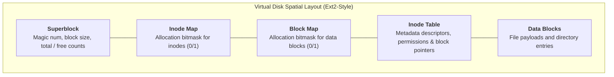

[简体中文](README.md) | English

# Linux File System Simulator · Simdisk

**A cross-platform C++17 implementation of a 100MB virtual Linux file system with multi-user permissions.**

`simdisk` is a systems programming simulator modeling fundamental UNIX/Linux file system internals: Superblocks, Inode allocation tables, block allocation bitmaps, and directory entries. Supporting multi-user permission hierarchies, file read/write locks, hierarchical path operations, and bidirectional file transfer between the host operating system and the simulated virtual drive. Modernized around C++17 and CMake, this refactored edition introduces cross-platform shared-memory IPC while resolving memory leaks and disk layout collisions.

---

## Architecture & Virtual Disk Layout

The virtual drive is mapped onto a single 100MB binary image structured into distinct disk segments:



* **Modular Subsystems**:
  * `filesystem`: Disk formatting, Superblock management, Inode allocations, and free-block bitmap indexing;
  * `auth`: User authentication, role-based authorization (root / system / user), and access control;
  * `commands`: Parser and execution dispatcher for standard UNIX-like shell commands;
  * `ipc`: Cross-platform shared-memory abstraction (Windows `CreateFileMapping` / POSIX `shm_open + mmap`) using fixed-length POD binary communication packets.
* **Host-Guest Bidirectional I/O**: Supports copying files seamlessly between the host filesystem and the virtual disk.
* **Dual Execution Modes**:
  * **Console Mode (`simdisk`)**: Interactive single-process shell (recommended for general usage);
  * **Client/Server Mode (`simdisk-server` + `simdisk-shell`)**: Headless core engine coupled with an independent shell client communicating over shared memory.

---

## Command Reference

| Command | Usage & Example | Description |
| :--- | :--- | :--- |
| `info` | `info` | Displays total disk capacity, allocated blocks, and Inode utilization |
| `cd` | `cd <path>` | Changes working directory (supports `/`, `..`, and absolute/relative paths) |
| `dir` | `dir` | Lists current directory contents (permissions, sizes, timestamps, owners) |
| `md` / `rd` | `md <dir>` / `rd <path>` | Creates a directory / Recursively removes a directory |
| `newfile` | `newfile <file> [content]` | Creates a new file (supports inline payload or multiline interactive input) |
| `cat` | `cat <path>` | Prints file contents with permission checks |
| `copy` | `copy <src> <dest>` | Copies files within the virtual file system |
| `copy (Import)` | `copy D:\local.txt /guest_dir` | Copies a host file into the virtual disk |
| `copy (Export)` | `copy /guest_file.txt D:\out` | Exports a virtual file to the host OS |
| `del` | `del <path>` | Deletes a virtual file and reclaims disk blocks |
| `adduser` | `adduser <user> <pass> <role>`| Registers a new user (root only) |
| `check` | `check` | Flushes cached Inodes and Superblock state back to the disk image |

---

## Build & Run

### Prerequisites
* **C++ Standard**: C++17 or newer
* **Compiler**: GCC 9+, Clang 10+, or MSVC 2019+
* **Build System**: CMake 3.15+

### Compilation

```bash
# Generate build files
cmake -S . -B build

# Compile all targets
cmake --build build
```

### Running the Simulator

```bash
cd build

# Launch standalone console shell
./simdisk
```

*On initial startup, enter `Y` when prompted to format the 100MB virtual disk. The default administrator credentials are `root` with password `password`.*

---

## License

This project is open-sourced under the [MIT License](LICENSE).
